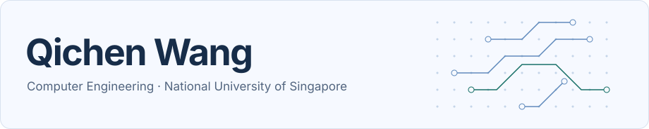
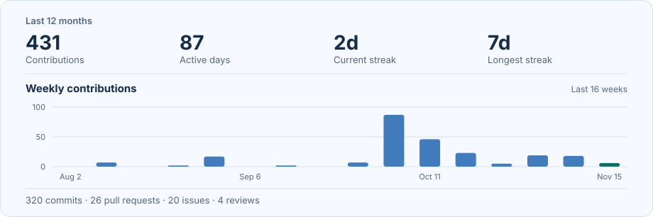

<picture>
  <source media="(prefers-color-scheme: dark)" srcset="https://raw.githubusercontent.com/77chenchen/77chenchen/output/profile-intro-dark.svg" />
  
</picture>

[Email](mailto:e1719536@u.nus.edu) · [Repositories](https://github.com/77chenchen?tab=repositories)

## Tech Stack

| Area | Technologies |
| :--- | :--- |
| Systems & hardware | C, C++, Verilog, CMake, Linux |
| Application development | Python, Java, Go, Swift, JavaScript, TypeScript, HTML, CSS, React, Node.js |
| Developer tools | Docker, Git, GitHub, Bash, VS Code |

## GitHub Activity

<picture>
  <source media="(prefers-color-scheme: dark)" srcset="https://raw.githubusercontent.com/77chenchen/77chenchen/output/profile-activity-dark.svg" />
  
</picture>

## Contribution Snake

<picture>
  <source media="(prefers-color-scheme: dark)" srcset="https://raw.githubusercontent.com/77chenchen/77chenchen/output/profile-snake-dark.svg" />
  
</picture>

